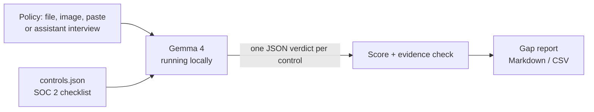

# 🔎 PolicyLens

**Offline SOC 2 policy gap analysis powered by Gemma 4.**

GRC teams paste confidential security policies into cloud AI tools to check them against compliance frameworks. PolicyLens does that job **100% offline**, using Gemma 4 running on your own laptop. Nothing leaves your machine.

Built for **Hacktoberfest Hack Day Ahmedabad 2026**.

## What it does

1. **Input a policy**, one of four ways:
   - 🛡️ **GRC Workspace:** no policy yet? An AI auditor interviews you, ticks off SOC 2 topics on a **live checklist** as you answer, asks follow-ups on what you missed ("Does MFA also apply to VPN users?"), then writes the policy from your answers.
   - 📄 Upload a `.txt` / `.md` policy
   - 🖼️ Upload a **photo or screenshot** of a policy page (Gemma 4 vision reads it)
   - ✍️ Paste text
2. **Analyse:** Gemma 4 checks the policy against SOC 2 Trust Services Criteria, **one control at a time**.
3. **Review:** each control is rated **Covered / Partial / Missing** with the **policy clause used as evidence**. A reviewer confirms or overrides each verdict, adds notes and signs off.
4. **Report:** coverage score, top priority fixes, **ready-to-paste policy text** for every gap, and the **evidence an auditor will ask for**. Download as **PDF, Word, HTML, Excel/CSV, Markdown or JSON**.

## Accuracy without losing speed

| Check | What it catches | Cost |
|---|---|---|
| Double-check on "Covered" | A wrong "Covered" hides a real gap, so every Covered verdict gets a second strict opinion. Disagreement → 🚩 flagged | Extra call only for Covered controls |
| Citation verification | Clause numbers the model cites that don't exist in the policy → 🚩 flagged | Instant, no AI |
| Human review and sign-off | Reviewer overrides any verdict; the report shows AI verdict vs final status and who signed off | No AI |
| Parallel checks | Several controls checked at once | Faster |
| Result cache | Re-running the same policy | Instant |

## Why not just ask the model in a chat?

| Plain chat with a model | PolicyLens |
|---|---|
| Picks its own controls, may invent control IDs | Fixed checklist in `controls.json` |
| Different answer every time | Temperature 0, structured JSON output: repeatable |
| Misses details when checking everything at once | One control per call keeps a small model focused |
| No proof | Evidence is mandatory, and cited clause numbers are **verified** against the policy |
| Wall of text | Score, colour-coded table, downloadable report |

## How it works



## Quick start

1. Install [LM Studio](https://lmstudio.ai), download **Gemma 4** (e.g. `google/gemma-4-12b-qat`), open the **Developer** tab and click **Start Server**.
2. Double-click **Start PolicyLens.bat** (Windows), or install and run:
   ```bash
   pip install -r requirements.txt
   streamlit run PolicyLens.py
   ```
3. In the browser, click **Use the sample policy**, then **Analyse policy**.

## Use any model

PolicyLens talks to any OpenAI-compatible server. Change the URL and model in the sidebar, or the two lines at the top of `ui.py`:

| Server | URL | Model example |
|---|---|---|
| LM Studio | `http://localhost:1234/v1` | `google/gemma-4-12b-qat` |
| Ollama | `http://localhost:11434/v1` | `gemma3`, `llama3.1` |

Image input needs a vision model such as Gemma 4.

## Project structure

| File | Purpose |
|---|---|
| `PolicyLens.py` | Main page: upload, analyse, review, report |
| `pages/1_GRC_Workspace.py` | Interview agent with live auditor checklist |
| `engine.py` | Model calls, accuracy checks, interview agent, scoring |
| `ui.py` | Shared settings sidebar, review table, report view |
| `reports.py` | PDF, Word, HTML and JSON exports |
| `controls.json` | SOC 2 checklist: 16 controls across 10 areas, with evidence to collect (edit to add your own) |
| `sample_policy.txt` | Demo policy with deliberate gaps |
| `SKILL.md` | Agent skill: the same review method for any AI agent |

## Limitations

- AI-assisted draft only. A qualified GRC professional should review results before audit use.
- The checklist is a practical subset of SOC 2 criteria, not the full framework.
- Small local models can be slow on very long policies; check one policy at a time.

## Roadmap

- Map each finding to ISO 27001 Annex A, HIPAA and India's DPDP Act alongside SOC 2
- Before/after comparison: re-run a fixed policy and show the score change
- Check several policies in one batch

## License

MIT, see `LICENSE`.
